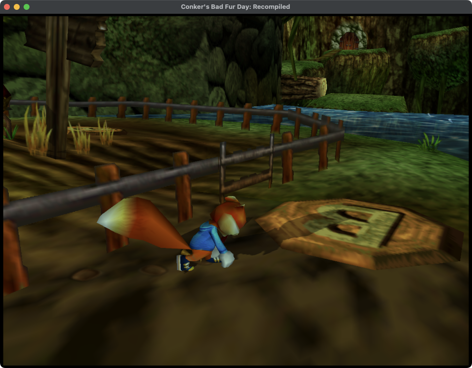

# Conker's Bad Fur Day: Recompiled

A static recompilation of *Conker's Bad Fur Day* (Nintendo 64, US release)
built with [N64Recomp](https://github.com/N64Recomp/N64Recomp) and
[N64ModernRuntime](https://github.com/N64Recomp/N64ModernRuntime), fed by the
[conkers-bfd-decomp](https://github.com/DevOldSchool/conkers-bfd-decomp)
project's function inventory.

The plan is the hybrid one: start from a full static recompilation so there
is a running build now, and replace recompiled functions with decompiled C as
the decomp finishes them. The decomp is at roughly 27% matched code; this
project does not wait for it.

This repository contains no ROM data. You need your own US ROM
(SHA-1 `4cbadd3c4e0729dec46af64ad018050eada4f47a`).

## Status

| Piece | State |
| --- | --- |
| Symbol file from the decomp inventory, ELF and evidence docs | done: 5,900+ functions across main, game and debugger overlays, SDK copies in the game overlay named so the runtime replaces them |
| Static recompilation | done: every function recompiles; 13 CP0/TLB/exception routines are stubbed; Rare's handwritten geometry code and one handwritten prefix-code tree builder are recompiled as shared code regions |
| Runtime | boots through the legal and Nintendo screens, intro cutscene, title scene, menus, the new game's opening, its first save and the first playable area, in both builds; no known crash (see "Current state") |
| Crash diagnostics | crash reporter with MIPS registers, per-thread call trace, `tools/symbolicate.sh`; display-list dumper and scripted Start press (see "Diagnostics") |
| Graphics: RT64 support for Rare's F3DEX2CBFD microcode | working through the first area: all eight variants recognised, the intro cutscene, the title scene, the menus, the opening cutscenes and the first area render in an RT64 window (`CONKER_RENDERER=rt64`); the title scene matches a cycle-accurate emulator render, including the weasels' tails that looked like stray polygons; see [docs/rsp-microcode.md](docs/rsp-microcode.md) |
| Audio: RSPRecomp of the `n_aspMain` microcode | working through the intro and title scene: Rare's MP3-capable audio microcode recompiled with its overlays, SDL2 output in the RT64 build, WAV dump with `CONKER_DUMP_AUDIO`; music in tune and MP3 voice at the right pitch and speed (checked against the decomp's extracted assets); title music no longer drops out (a timing race fixed by a hook in `src/hooks.cpp`); see [docs/rsp-microcode.md](docs/rsp-microcode.md#audio-n_aspmain-with-the-mp3-overlay) |
| Input | RT64 build: the first SDL game controller (hot-plug) and the keyboard drive controller 1, OR-ed with scripted Start presses; analog stick with a radial deadzone; no remapping UI (see "Controls"). Title menus, NEW GAME, the pause menu, loading a saved game and walking Conker around the first area driven by a scripted virtual pad (`CONKER_VIRTUAL_PAD`); keyboard not yet tried by hand. The null build has no input device |
| Saving: EEPROM | working: reads, single-block writes and Rare's paced long write (one 8-byte block per 12 ms timer tick) go to the runtime's save file (`conker-recomp-data/saves/conker_us.bin`); the new game's first save completes and matches its RDRAM buffer byte for byte, and the saved game loads from the title menu (see "Current state") |
| Windows support for the memory aliasing | not started |

### Current state

With a controller (or the keyboard, or `CONKER_VIRTUAL_PAD`) the RT64 build
boots, goes through the title scene and the NEW GAME menu, plays the new
game's opening (the credits, the throne-room cutscene and Conker's scene
outside the Cock and Plucker, "WHAT, AGAIN?" ... "SORRY ABOUT THAT, OLD
CHAP."), saves, and reaches the first playable area. There the stick walks
Conker around, and the camera follows (picture below). Start pauses the
cutscenes and the stick moves between QUIT and CONT. The saved game shows up
on the title menu's GAME 1 page (play time 0:06:03 and a picture of the first
area) and PLAY loads it, which is the quick way back to the first area (see
"Skipping the opening" under "Diagnostics"). The null build runs through the
save (around graphics task 13,000) and on into the first area too, with only
`CONKER_PRESS_START=5400,7500`: a 13-minute run (graphics task 22,800) ended
on the timer, not a crash.




In RT64 the title scene and the menus match a cycle-accurate emulator render.
The grey shapes on the weasels in the bar are their tails, drawn the same way
by the original game. That analysis, and the fixes that got the game this far
(the scene `0x1D` crash, the intro hang, the first-save hang and the geometry
code's escape), are written up in [docs/investigations.md](docs/investigations.md).


## Enhancements

Changes from how the game behaves on an N64:

| Enhancement | Details |
| --- | --- |
| Skippable intro | Start skips the intro (Conker sawing the N64 logo) once it has run for about five seconds; earlier presses are ignored, as in the original game. On an N64, Start only skips it after the reset button was pressed, so the recomp reports a warm reset to that check. `CONKER_SKIP_INTRO=1` skips the intro without a press; `CONKER_SKIP_INTRO=0` makes it unskippable, as on a cold boot. |
| Camera on the right stick | C-left and C-right are swapped on the right stick and on J/L, so pushing left turns the view left (see "Controls"). |

## Layout

```
config/us.toml          N64Recomp configuration (stub list lives here)
config/us.syms.toml     generated: sections and functions at runtime addresses
config/aspMain.toml     RSPRecomp configuration for the audio microcode
tools/gen_syms.py       builds us.syms.toml and the virtual ROM from the decomp
tools/regenerate.sh     extraction + generation + recompilation in one go
tools/cbfd_dl.py        offline display-list replay from a CONKER_DUMP_RDRAM image
tools/patches/          patches applied to the N64Recomp, N64ModernRuntime and RT64 submodules
src/                    runtime glue: entry, memory windows, RZIP, overlays, renderers, window, audio, input, hooks
docs/memory-layout.md   why main runs at 0x10001000 and the game at 0x15000000
docs/rsp-microcode.md   the microcode situation and the RT64 work
lib/N64Recomp           recompiler (submodule, patched; see tools/patches)
lib/N64ModernRuntime    libultra reimplementation and recomp glue (submodule)
lib/rt64                renderer (submodule, patched for F3DEX2CBFD; CONKER_RENDERER=rt64)
```

## Building

Requirements: CMake 3.20+, Ninja, clang with C++20, Python 3, and a checkout
of the decomp next to this one (`../conkers-bfd-decomp`) with the ROM at
`roms/baserom.us.z64`. The decomp's `build/us/original-assets/conker.us.elf`
(from `./conker build`) improves symbol names for main's SDK code but is
optional.

```sh
git submodule update --init --recursive
(cd lib/N64Recomp && git apply ../../tools/patches/n64recomp.patch)
(cd lib/N64ModernRuntime && git apply ../../tools/patches/n64modernruntime-running-thread.patch)
(cd lib/N64ModernRuntime && git apply ../../tools/patches/n64modernruntime-pi-dma-message.patch)
tools/regenerate.sh
cmake -S . -B build/host -G Ninja -DCMAKE_BUILD_TYPE=RelWithDebInfo
cmake --build build/host
build/host/ConkerRecomp /path/to/conker-us.z64
```

The default build uses the null renderer: no window, graphics tasks are only
logged. For a window rendered by RT64, apply the CBFD patch to the RT64
submodule and configure with `CONKER_RENDERER=rt64`. This needs SDL2
(`brew install sdl2`) and, on macOS, Xcode's Metal toolchain for RT64's shaders
(`xcodebuild -downloadComponent MetalToolchain` on Xcode 26 or later):

```sh
(cd lib/rt64 && git apply ../../tools/patches/rt64-f3dex2cbfd.patch)
cmake -S . -B build/rt64 -G Ninja -DCMAKE_BUILD_TYPE=RelWithDebInfo -DCONKER_RENDERER=rt64
cmake --build build/rt64
build/rt64/ConkerRecomp /path/to/conker-us.z64
```

RT64 prints `GBI: F3DEXBG.NoN fifo 2.08 (Conker)` when it recognises the
microcode of the first graphics task.

### Controls

The RT64 build reads controller 1 from the first SDL game controller and from
the keyboard at the same time; the null build has no input device. A
controller can be plugged in or removed while the game runs (the log prints
`[conker] controller 1: <name>`). There is no remapping yet.

| N64 | Game controller (Xbox names, PlayStation in brackets) | Keyboard |
| --- | --- | --- |
| Analog stick | left stick (20% radial deadzone) | W A S D or the arrow keys |
| A | A | Space |
| B | X or B | Left Shift |
| Z | right trigger (R2) or left trigger (L2) | Q |
| L | left bumper (L1) | Tab |
| R | right bumper (R1) | E |
| Start | Start | Enter |
| C buttons | right stick | I J K L (up, right, down, left) |
| D-pad | D-pad | T F G H (up, left, down, right) |

C-left and C-right are swapped on the right stick and on J/L. Conker turns
the camera the opposite way to the C button pressed, so on the N64 C-left
swings the view to the right; with the swap, left on the stick (or J) turns
the view left, as in most modern games.

The stick reaches the N64 range of about ±80 on the axes. The keyboard stick
is always fully tilted. In the menus, move with the stick and confirm with A
(Start also works on the title screen and pauses during play).

On a crash the binary prints the faulting N64 address, the MIPS registers,
the last 64 recompiled function entries on that thread and the image slide;
`tools/symbolicate.sh build/host/ConkerRecomp <log>` maps the host backtrace
to generated C lines and N64 instruction addresses.

`regenerate.sh` extracts the compressed game overlay with the decomp's RZIP
tool, writes `config/us.syms.toml` plus a virtual ROM (the real ROM with the
decompressed game images appended, read only by N64Recomp), runs the
recompiler into `build/us/RecompiledFuncs` and RSPRecomp into
`build/us/rsp/aspMain.cpp`. From a git worktree, point it at the decomp with
`CONKER_DECOMP=/path/to/conkers-bfd-decomp`.

The RT64 build plays sound through SDL2; the null build renders the audio but
has no output device.

### Diagnostics

These environment variables are read by both builds:

* `CONKER_DUMP_DL=<task>[,<task>...]` prints every command of the listed
  graphics tasks (1-based). It walks the F3DEX2-style display list from the
  task's data pointer, follows `gSPDisplayList` (`DE`), returns at
  `gSPEndDisplayList` (`DF`), applies `gSPSegment` bases and resolves image
  addresses (`FD`/`FE`/`FF`). While the variable is set, a one-line summary is
  also printed every 60 tasks and whenever the command count changes: command,
  list, triangle and rectangle counts, colour image, content hash and texture
  addresses. `CONKER_DUMP_DL=0` gives only the summaries.
* `CONKER_DUMP_RDRAM=1` also writes `conker-task-<n>.rdram` (8 MiB,
  big-endian) for each fully dumped task, so its textures can be decoded
  offline.
* `tools/cbfd_dl.py <rdram> <dl>` replays one of those RDRAM images offline
  without RT64. It tracks segments, matrices, the viewport and the vertex
  buffer, prints each model instance's screen-space bounding box, and with
  `--largest N [--instance <seg3>]` prints the largest triangles and where
  their vertices came from. Use it to tell bad data in RDRAM apart from a
  renderer that misreads good data.
* `CONKER_SKIP_INTRO=1` skips the intro cutscene by itself, about five
  seconds in, so the title scene starts around VI 1,180 instead of 2,550. VI
  numbers in input scripts written for a full intro (such as the ones below)
  are then about 1,370 too late.
* `CONKER_PRESS_START=<vi>[,<vi>...]` holds Start on controller 1 for 10 VIs
  from each listed VI count, on top of any real input.
* `CONKER_VIRTUAL_PAD=<file>` (RT64 build) attaches an SDL virtual game
  controller driven by a script, so the whole controller path can be tested
  without hardware. Each line is `<vi> <length in VIs> <control>...`, where a
  control is an SDL button name (`a`, `b`, `x`, `start`, `leftshoulder`,
  `dpup`, ...) or `<axis>=<value>` (`leftx`, `lefty`, `rightx`, `righty`,
  `lefttrigger`, `righttrigger`, from -1 to 1, with +y down as in SDL). `#`
  starts a comment. For example, `5400 10 start` then `7500 10 a` goes from the
  title scene to a new game.
* **Skipping the opening.** Saves persist in
  `conker-recomp-data/saves/conker_us.bin` under the working directory, so
  keep a copy of that file from a run that got past the first save (about
  7 minutes in) and put it back before later runs. With a save present,
  `5400 10 start` opens the GAME 1 page and `6600 10 a` picks PLAY, which
  loads the first area about 2 minutes after boot. Leave the stick alone on
  that page: pushing it moves the lever to ERASE, and a second A erases the
  save. An emulator-style save state is not possible here, because each N64
  thread runs as a native host thread with its own C stack.
* `CONKER_DUMP_AUDIO=<file.wav>` records every buffer the game queues
  (16-bit stereo at the game's 22,020 Hz) in either build. The log prints a
  line every 5 s of audio with the peak, RMS, minimum output-queue depth and
  underrun count.
* `CONKER_AUDIO=0` (RT64 build) disables the SDL device; `CONKER_AUDIO_LATENCY_MS`
  (default 60) sets the extra buffering kept on top of what the game asks for;
  `CONKER_SILENT_AUDIO=1` skips the audio microcode entirely.

## How the recompilation is set up

* Conker links its main executable for a TLB alias at `0x10000000` and its
  game overlay for `0x15000000`, demand-paged 4 KiB at a time from RZIP
  chunks. Sections are described at those runtime addresses so every call,
  address constant and jump table resolves. Details in
  [docs/memory-layout.md](docs/memory-layout.md).
* Function boundaries come from the decomp's `progress/functions.json`, its
  ELF for main's SDK code, `config/game/us-sdk.ld` for SDK code in the game
  overlay, and direct-call targets for anything left uncovered.
* The runtime makes the `0x10000000` window a shared-memory alias of RDRAM,
  inflates the game overlay into the `0x15000000` window, copies the debugger
  overlay to `0x16000000`, and registers every function at its runtime
  address so function-pointer calls resolve.
* The 13 stubbed functions are listed with reasons in `config/us.toml`.
* libultra internals Rare calls directly (SI/PIF access, SP task submission by
  raw DMA, VI/timer internals, controller-pak code, libc helpers) are
  implemented natively in `src/ultra_extras.cpp`; `tools/gen_extras_decl.py`
  keeps the list of required ones in sync.
* `[[patches.hook]]` snippets in `config/us.toml` call helpers in
  `src/hooks.cpp`, for example to keep the music manager from dropping a
  sequence the audio thread has not started yet (see
  [docs/rsp-microcode.md](docs/rsp-microcode.md)), and to carry out the
  geometry code's escape from `func_150AE280` back to `func_150ADAF0`'s
  caller with `setjmp`/`longjmp` (`src/region_escape.h`). Hooks inside a
  shared code region go on the region's first function (`func_150A3A70`),
  because the region's single body is emitted with it.

## Patches to the submodules

`tools/patches/n64recomp.patch` (apply in `lib/N64Recomp`):

* jump tables may live in a different section from their function (IDO puts
  main's tables in rodata at a KSEG0 address while the code runs through the
  TLB alias);
* one run reports every failing function instead of stopping at the first;
* **shared code regions**: a section may declare `regions = [{ start, end }]`.
  Every function inside is emitted as a thin wrapper around one body per
  region, which begins with a `switch` over every instruction address. Entries,
  computed jumps (`jr $reg`) and `jr $ra` with an explicitly loaded `$ra`
  resolve to labels; the wrapper seeds `$ra` with a sentinel so routines that
  return through another register (`or $t7, $ra` ... `jr $t7`) still return.
  Calls inside a region to targets in the same region link `$ra` and jump to
  the label (hardware semantics, since the callee may return through a
  continuation register), `jalr` links and dispatches, and the jump register
  of `jr`/`jalr` is read before the delay slot runs. This is how Rare's
  handwritten geometry code (0x150A3A70:0x150AE35C) and the handwritten
  prefix-code tree builder `func_15018500` (0x15018500:0x150186D0, returns
  through `$s4`) are recompiled;
* stack accesses with negative or unaligned offsets, tables without in-function
  entries and undecodable words no longer fail a function; writes to `$zero`
  are discarded.

`tools/patches/n64modernruntime-running-thread.patch` (apply in
`lib/N64ModernRuntime`) adds `ultramodern::set_running_thread_address`, a
libultra-style `__osRunningThread` mirror that Rare's code reads directly.

`tools/patches/n64modernruntime-pi-dma-message.patch` (apply in
`lib/N64ModernRuntime`) makes `osPiStartDma` fill in the `OSIoMesg` (type,
priority, return queue, addresses, size) and makes PI DMA completion send that
`OSIoMesg` pointer to the return queue, as libultra's PI manager does, instead
of a null message.

`tools/patches/rt64-f3dex2cbfd.patch` (apply in `lib/rt64`) adds Rare's
F3DEX2CBFD microcode: GBI database entries for the eight variants, a
`GBI_F3DEX2CBFD` command table on top of F3DEX2 and the RSP state for its
vertex normals, 48-byte lights, coordinate modifiers and TRI4. Details in
[docs/rsp-microcode.md](docs/rsp-microcode.md).

All of these are candidates for upstreaming.
