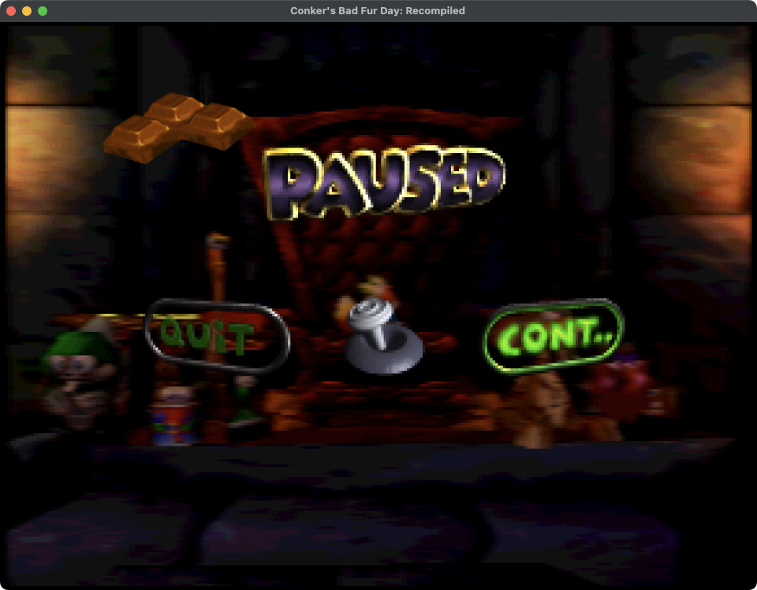
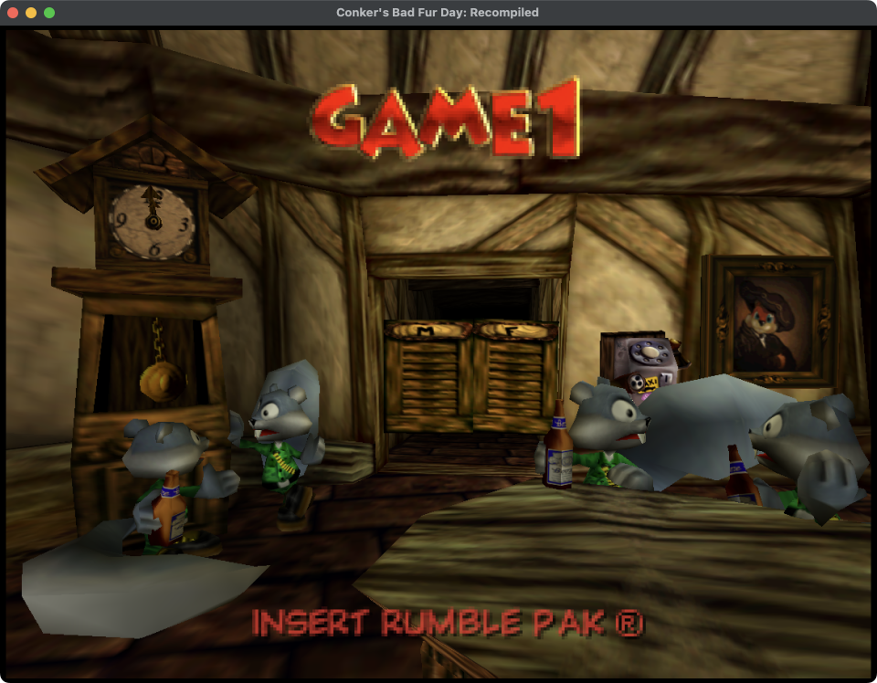
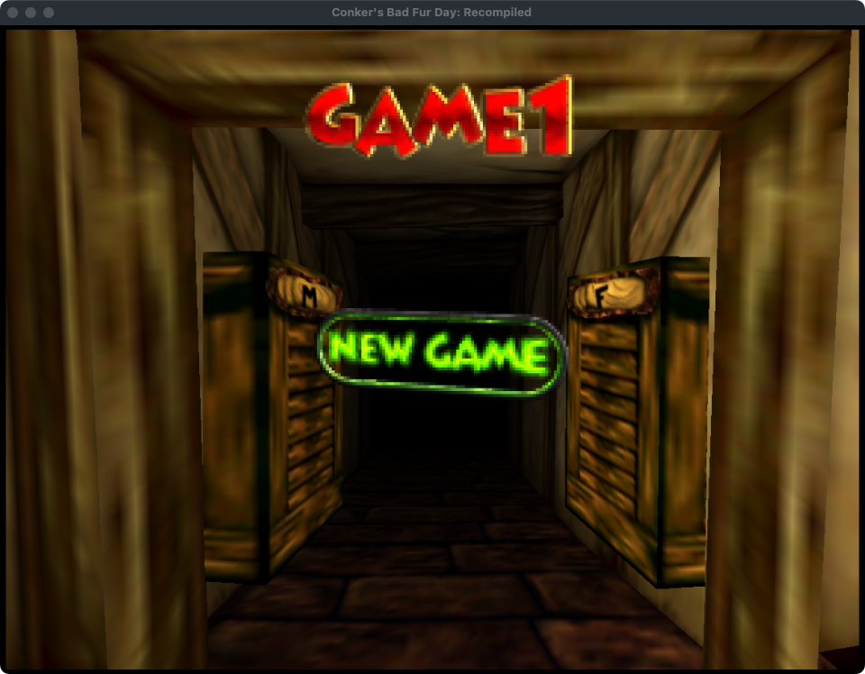
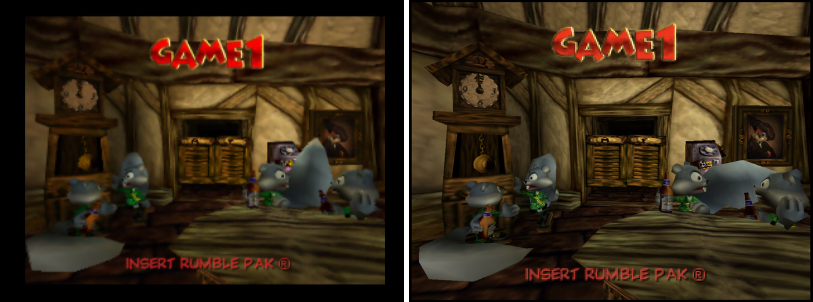
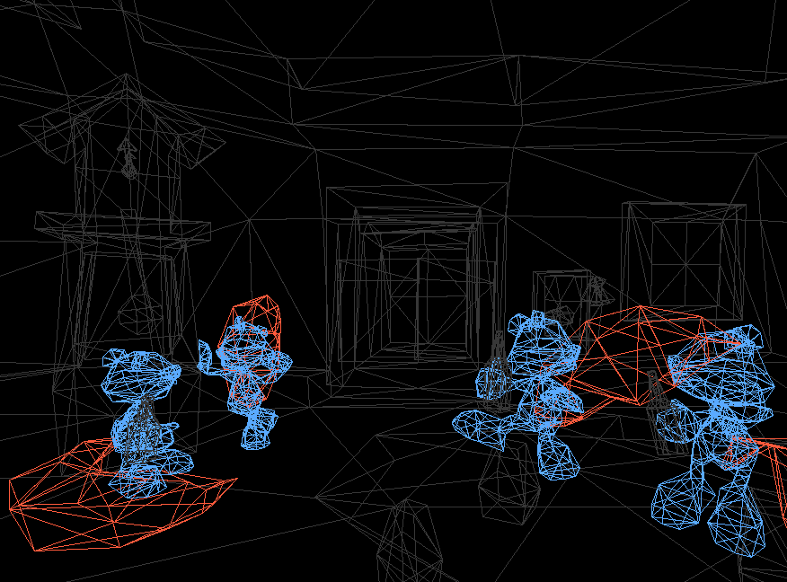
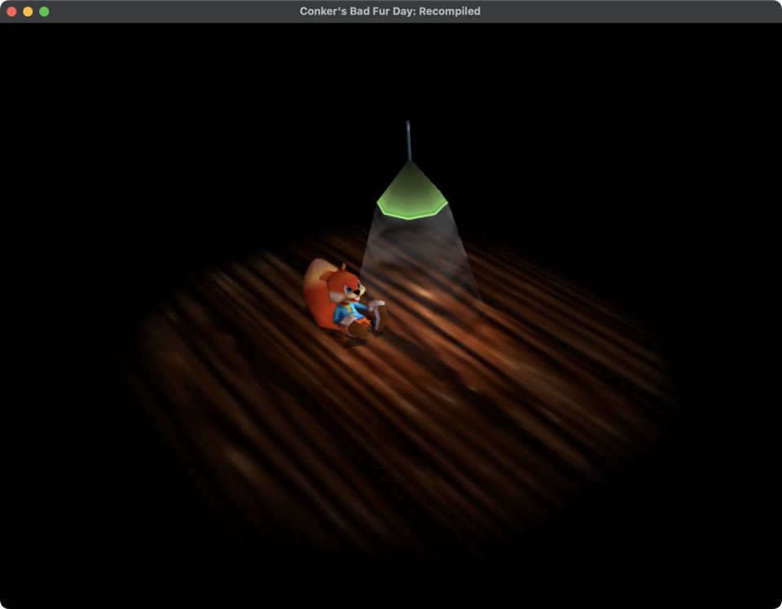

# Conker's Bad Fur Day: Recompiled

A static recompilation of *Conker's Bad Fur Day* (Nintendo 64, US release)
built with [N64Recomp](https://github.com/N64Recomp/N64Recomp) and
[N64ModernRuntime](https://github.com/N64Recomp/N64ModernRuntime), fed by the
[conkers-bfd-decomp](https://github.com/DevOldSchool/conkers-bfd-decomp)
project's function inventory.

The plan is the hybrid one: start from a full static recompilation so there
is a running build now, and replace recompiled functions with decompiled C as
the decomp finishes them. The decomp is at roughly 27% matched code; this
project does not wait for it.

This repository contains no ROM data. You need your own US ROM
(SHA-1 `4cbadd3c4e0729dec46af64ad018050eada4f47a`).

## Status

| Piece | State |
| --- | --- |
| Symbol file from the decomp inventory, ELF and evidence docs | done: 5,900+ functions across main, game and debugger overlays, SDK copies in the game overlay named so the runtime replaces them |
| Static recompilation | done: every function recompiles; 13 CP0/TLB/exception routines are stubbed; Rare's handwritten geometry code and one handwritten prefix-code tree builder are recompiled as shared code regions |
| Headless runtime (no graphics, sound output or input) | boots: ROM load, game-archive inflation, thread creation, main init, game entry, software-geometry setup, visibility-partition build, main loop, legal and Nintendo screens, intro cutscene, title scene, menus after a scripted Start press; no known crash (see below) |
| Crash diagnostics | crash reporter with MIPS registers, per-thread call trace, `tools/symbolicate.sh`; display-list dumper and scripted Start press (see "Diagnostics") |
| Graphics: RT64 support for Rare's F3DEX2CBFD microcode | first light: all eight variants recognised, the intro cutscene, the title scene and the menus render in an RT64 window (`CONKER_RENDERER=rt64`); the title scene matches a cycle-accurate emulator render, including the weasels' tails that looked like stray polygons; see [docs/rsp-microcode.md](docs/rsp-microcode.md) |
| Audio: RSPRecomp of the `n_aspMain` microcode | working through the intro and title scene: Rare's MP3-capable audio microcode recompiled with its overlays, SDL2 output in the RT64 build, WAV dump with `CONKER_DUMP_AUDIO`; music in tune and MP3 voice at the right pitch and speed (checked against the decomp's extracted assets); see [docs/rsp-microcode.md](docs/rsp-microcode.md#audio-n_aspmain-with-the-mp3-overlay) |
| Input | RT64 build: the first SDL game controller (hot-plug) and the keyboard drive controller 1, OR-ed with scripted Start presses; analog stick with a radial deadzone; no remapping UI (see "Controls"). Title menus, NEW GAME and the pause menu navigated with a scripted virtual pad (`CONKER_VIRTUAL_PAD`); keyboard not yet tried by hand. The null build has no input device |
| Saving: EEPROM | reads and single-block writes go to the runtime's save file (`conker-recomp-data/saves/conker_us.bin`); Rare's paced long write hangs at the first save (see "Current state") |
| Windows support for the memory aliasing | not started |

### Current state

With a controller (or the keyboard, or `CONKER_VIRTUAL_PAD`) the RT64 build
boots, goes through the title scene and the NEW GAME menu, and plays the new
game's opening: the credits, the throne-room cutscene and Conker's scene
outside the Cock and Plucker ("WHAT, AGAIN?" ... "SORRY ABOUT THAT, OLD
CHAP."). Start pauses the cutscene and the stick moves between QUIT and
CONT. (picture below). **The game then hangs at its first save**, so Conker has not been moved
in the first playable area yet. The window stays black, no more graphics tasks
arrive, and the audio thread keeps rendering near-silence. The null build
stops at the same point.

What is known about the hang:

* The game's save routine (`func_15006BEC`) writes one EEPROM block itself and
  then starts Rare's paced long write (`func_151DCEF0`). That routine records
  the request, then arms a 12 ms timer (`osSetTimer(0x80042A58, 750000 ticks,
  0, 0x80042A78, 0x80042A90)`). Each call to `__conker_eeprom_wait`
  (`0x151DCFD8`) takes one timer message from the queue at `0x80042A78`,
  writes the next 8-byte block and re-arms the timer.
* Before this branch, the write itself hung. `0x151DD4E0` is Rare's
  `osEepromWrite`, but it had no libultra name, so it ran recompiled: raw SI
  DMA to the PIF shim, then `osRecvMesg` for an SI interrupt that the shim
  never sends. It is now named `osEepromWrite` (`CONKER_RENAMES` in
  `tools/gen_syms.py`), so the runtime's native version writes the save file.
* The game now gets one block further (block 67 lands in the save file) and
  then blocks in `__conker_eeprom_wait(1)` → `osRecvMesg(0x80042A78)`. An
  RDRAM dump taken a little earlier (graphics task 12,000) shows the
  `OSMesgQueue` at `0x80042A78` as all zeros (`msgCount` 0, no buffer), so
  the runtime treats it as full and drops the timer's message. No code in the
  recompiled output forms that address except the two timer calls and the
  receive, so the queue is probably created by a routine the runtime
  reimplements, or through a pointer computed elsewhere. This is still open.



### Where the headless boot stops

It no longer stops. The headless run plays the boot sequence and the intro
cutscene (scene `0x21`), enters the title scene `0x1D` in the Cock and Plucker
bar around graphics task 1,270 and stays there, animated, waiting for input:
a 4-minute run reached task 6,332 without a crash. With scripted Start
presses (`CONKER_PRESS_START=5400,6000,6600,7200,7800,9000,10200`) it goes
through the bar doors to the NEW GAME menu, loads scene `0x18` and plays the
new game's opening: the credits ("Nintendo presents", "A Rareware game",
"Starring Conker & Berri"), then the throne-room cutscene. The later presses
pause and resume it (the PAUSED / QUIT / CONT. menu appears; its options were not tried). A 5.5-minute run
with those presses ended on the timer, not a crash. Nothing past the opening
cutscene has been tried yet.

In RT64 the title scene and the menus look right. The large grey shapes on
the weasels at the bar (picture below) are **not a rendering bug**. They are
the weasels' bushy tails, and the original game draws them the same way (see
"The grey shapes on the weasels" below).





**The grey shapes on the weasels.** These were reported as stray polygons and
suspected to come from the F3DEX2CBFD support. They are part of the model:

* An emulator running the original ROM draws them in the same places, with
  the same shape and shading. In the picture below, the left side is Mupen64Plus
  with CXD4 (low-level RSP: the real microcode runs) and Angrylion RDP Plus,
  title scene at frame 3,600, from the decomp's `./conker mupen-trace
  --software-renderer -- --testshots`. The right side is the RT64 window
  above. The animation phase differs, but the floor sheet under the left
  weasel and the sheet behind the second weasel's head are present in both.
* Replaying the display list from RDRAM without RT64 (`tools/cbfd_dl.py` on a
  `CONKER_DUMP_RDRAM` image of task 2,000) gives the same geometry. Each weasel
  is drawn by display list `0x22D528` with its own bone-matrix palette in
  segment 3 (five instances: `0x12F440`, `0x12FE40`, `0x130840`, `0x131240`,
  `0x131C40`). Its first two vertex groups, commands
  `0x22D5E8`-`0x22D718`, are a five-bone chain (palette slots
  `0x880`-`0x9C0`) whose matrices step away from the body by 30 to 45 units
  each. They use the grey fur texture at `0x21A760` (palette `0x21ACE0`). That
  chain is the tail, and its triangles (orange in the wireframe below) are
  exactly the grey shapes.
* RT64 therefore receives correct data and draws it correctly, so the CPU side
  (bone matrices from `func_150A9984` in the handwritten region) and the CBFD
  command decoding (VTX, TRI4, MTX) are not at fault here.





**Why scene `0x1D` used to crash.** Creating the title scene's trigger node
`0xC8` decodes a compressed table through `func_150183D0`, which calls
`func_15018500` to build a prefix-code (Huffman-style) tree. `func_15018500` is handwritten
assembly with its own calling convention: it copies its return address with
`or $s4, $ra, $zero`, reads its caller's stack frame (`0x44($sp)`) without
allocating one, and returns with `jr $s4`. In the recompiled code, `jal` is a
plain host call and does not write `$ra`, so `$s4` got whatever stale value
`$ra` held, and N64Recomp had turned `jr $s4` into a lookup of that value
called as a tail call. A temporary trace showed `$ra = 0` on entry and
`$s4 = 0` at the `jr`, then "Failed to find function at 0x00000000". The fix
declares `0x15018500:0x150186D0` as a second shared code region
(`GAME_REGIONS` in `tools/gen_syms.py`). The region wrapper seeds `$ra` with
the sentinel, and `jr $s4` returns when it sees it. The recompiler's own report
lists this as the only indirect tail call (`jr` through a register other than
`$ra`, with no jump table) outside the existing regions. The decomp's
`functions.json` names four custom-ABI routines (`func_15018500`,
`func_150A76F0`, `func_150A7A14`, `func_150AA644`), and the other three lie
inside the geometry region.

The intro scene as PR #3 first rendered it, stuck before its cutscene script
(fixed in PR #4, explained below):



What the display-list dumper (`CONKER_DUMP_DL`) shows, with the screens
identified against emulator screenshots (`./conker mupen-trace
--software-renderer ... -- --testshots`):

| Graphics tasks | Display list | Screen |
| --- | --- | --- |
| 1-110 | 440 commands, 22 texture rectangles | blank or fade |
| 120-260 | 3,283 commands, 380 texture rectangles | legal text (Dolby, Miles, MPEG, Rare) |
| 270-420 | 296 commands, 4 texture rectangles | Nintendo logo |
| 422 on | ~1,900 commands, ~1,100 triangles, alternating buffers `0x10ADC0` / `0x122C20` | intro scene `0x21` (wooden floor, N64 logo, Conker) |

The earlier note that every task from about the 600th on used display list
`0x00122C20` was a sampling artefact: the log printed every 600th task, always
an even one, and the game double-buffers its display lists.

**Why the intro used to hang.** Before the fix in this section, the run never
got past the first shot of the intro scene. It rendered the scene's starting
state forever: Conker's textures are in the display list, but the shot never
changed. The cause was not missing input, EEPROM data, VI messages or audio:

* The intro is cutscene script 1 of scene `0x21`. It is started by a scene
  trigger node: `func_1509BBA0` walks the node list `D_800D2F48` every frame and
  runs each node's action through `func_150ADAF0`; action type 1 is
  `func_1509C440`, which installs the script with `func_1501D348(0x21, 1, ...)`.
  The emulator shows this happening (node at `0x800D5050`).
* In the recomp the node list was empty. Scene loading (`func_15002FB4`)
  reads the scene header's trigger count (`header[0x12]`). It also checks one
  ROM word with `osPiReadIo(0x40F0FAAC ^ 0xF0F0F0F0 = 0xB0000A5C)` and expects
  `0x1740FFF9 ^ 0xF0F0F0F0`. If the check fails, it **halves the trigger
  count**, which looks like Rare's anti-tamper measure. Scene `0x21` has one
  trigger, so halving left none.
* `osPiRawReadIo` in `src/ultra_extras.cpp` treated its argument as a cartridge
  physical address and returned 0 for the KSEG1 address `0xB0000A5C`.
  libultra reads `osRomBase | devAddr`, so the shim now masks the address the
  same way. With that fix the script clock runs from 0 to its end time (1,700
  ticks), the shots play out and the game moves on to scene `0x1D`.

The input shim had nothing to do with it. Controllers are read through
`osContGetReadData` (the runtime's `get_input`), not raw SI DMA. Holding Start
with `CONKER_PRESS_START=1800` at the stuck scene changed nothing, because the
skip check in `func_1501E05C` needs a running cutscene clock of at least 301
ticks. The game made no EEPROM access through the PIF shim before this point.

Other checks of this kind may be present. Any native shim that reads ROM, PI or
PIF state should behave like the hardware for every address form the game uses.

The last crash before the main loop ran was on the audio thread: `func_8000A03C` reads the
message the PI DMA completion puts on the queue at `0x800416F0` as the
`OSIoMesg` it passed to `osPiStartDma` (it compares `dramAddr` against its
sound-bank buffers). The runtime's PI code sent a null message and never
filled in the `OSIoMesg`; `tools/patches/n64modernruntime-pi-dma-message.patch`
makes it behave like libultra's PI manager.

Three translation bugs in the handwritten geometry region were fixed to get
here (the emulator trace of `func_15049260` entries and returns now matches
the recomp call for call):

* the runtime started every thread in the FR=0 FPU register layout, while the
  game runs with FR=1 (IPL3 sets it) and Rare's assembly does arithmetic on
  odd registers; `src/game.cpp` switches each thread to FR=1;
* `jal` inside the region was a nested host call, but the routines return
  through other registers (continuations loaded before the call), so the
  continuation ran twice; calls inside a region now link `$ra` and jump;
* `jr $t0` with a delay slot that writes `$t0`: the target is now read
  before the delay slot.

## Layout

```
config/us.toml          N64Recomp configuration (stub list lives here)
config/us.syms.toml     generated: sections and functions at runtime addresses
config/aspMain.toml     RSPRecomp configuration for the audio microcode
tools/gen_syms.py       builds us.syms.toml and the virtual ROM from the decomp
tools/regenerate.sh     extraction + generation + recompilation in one go
tools/cbfd_dl.py        offline display-list replay from a CONKER_DUMP_RDRAM image
tools/patches/          patches applied to the N64Recomp, N64ModernRuntime and RT64 submodules
src/                    runtime glue: entry, memory windows, RZIP, overlays, renderers, window, audio
docs/memory-layout.md   why main runs at 0x10001000 and the game at 0x15000000
docs/rsp-microcode.md   the microcode situation and the RT64 work
lib/N64Recomp           recompiler (submodule, patched; see tools/patches)
lib/N64ModernRuntime    libultra reimplementation and recomp glue (submodule)
lib/rt64                renderer (submodule, patched for F3DEX2CBFD; CONKER_RENDERER=rt64)
```

## Building

Requirements: CMake 3.20+, Ninja, clang with C++20, Python 3, and a checkout
of the decomp next to this one (`../conkers-bfd-decomp`) with the ROM at
`roms/baserom.us.z64`. The decomp's `build/us/original-assets/conker.us.elf`
(from `./conker build`) improves symbol names for main's SDK code but is
optional.

```sh
git submodule update --init --recursive
(cd lib/N64Recomp && git apply ../../tools/patches/n64recomp.patch)
(cd lib/N64ModernRuntime && git apply ../../tools/patches/n64modernruntime-running-thread.patch)
(cd lib/N64ModernRuntime && git apply ../../tools/patches/n64modernruntime-pi-dma-message.patch)
tools/regenerate.sh
cmake -S . -B build/host -G Ninja -DCMAKE_BUILD_TYPE=RelWithDebInfo
cmake --build build/host
build/host/ConkerRecomp /path/to/conker-us.z64
```

The default build uses the null renderer: no window, graphics tasks are only
logged. For a window rendered by RT64, apply the CBFD patch to the RT64
submodule and configure with `CONKER_RENDERER=rt64`. This needs SDL2
(`brew install sdl2`) and, on macOS, Xcode's Metal toolchain for RT64's shaders
(`xcodebuild -downloadComponent MetalToolchain` on Xcode 26 or later):

```sh
(cd lib/rt64 && git apply ../../tools/patches/rt64-f3dex2cbfd.patch)
cmake -S . -B build/rt64 -G Ninja -DCMAKE_BUILD_TYPE=RelWithDebInfo -DCONKER_RENDERER=rt64
cmake --build build/rt64
build/rt64/ConkerRecomp /path/to/conker-us.z64
```

RT64 prints `GBI: F3DEXBG.NoN fifo 2.08 (Conker)` when it recognises the
microcode of the first graphics task.

### Controls

The RT64 build reads controller 1 from the first SDL game controller and from
the keyboard at the same time; the null build has no input device. A
controller can be plugged in or removed while the game runs (the log prints
`[conker] controller 1: <name>`). There is no remapping yet.

| N64 | Game controller (Xbox names) | Keyboard |
| --- | --- | --- |
| Analog stick | left stick (20% radial deadzone) | W A S D or the arrow keys |
| A | A | Space |
| B | X or B | Left Shift |
| Z | left trigger | Q |
| L | left bumper | Tab |
| R | right trigger or right bumper | E |
| Start | Start | Enter |
| C buttons | right stick | I J K L (up, left, down, right) |
| D-pad | D-pad | T F G H (up, left, down, right) |

The stick reaches the N64 range of about ±80 on the axes. The keyboard stick
is always fully tilted. In the menus, move with the stick and confirm with A
(Start also works on the title screen and pauses during play).

On a crash the binary prints the faulting N64 address, the MIPS registers,
the last 64 recompiled function entries on that thread and the image slide;
`tools/symbolicate.sh build/host/ConkerRecomp <log>` maps the host backtrace
to generated C lines and N64 instruction addresses.

`regenerate.sh` extracts the compressed game overlay with the decomp's RZIP
tool, writes `config/us.syms.toml` plus a virtual ROM (the real ROM with the
decompressed game images appended, read only by N64Recomp), runs the
recompiler into `build/us/RecompiledFuncs` and RSPRecomp into
`build/us/rsp/aspMain.cpp`. From a git worktree, point it at the decomp with
`CONKER_DECOMP=/path/to/conkers-bfd-decomp`.

The RT64 build plays sound through SDL2; the null build renders the audio but
has no output device.

### Diagnostics

These environment variables are read by both builds:

* `CONKER_DUMP_DL=<task>[,<task>...]` prints every command of the listed
  graphics tasks (1-based). It walks the F3DEX2-style display list from the
  task's data pointer, follows `gSPDisplayList` (`DE`), returns at
  `gSPEndDisplayList` (`DF`), applies `gSPSegment` bases and resolves image
  addresses (`FD`/`FE`/`FF`). While the variable is set, a one-line summary is
  also printed every 60 tasks and whenever the command count changes: command,
  list, triangle and rectangle counts, colour image, content hash and texture
  addresses. `CONKER_DUMP_DL=0` gives only the summaries.
* `CONKER_DUMP_RDRAM=1` also writes `conker-task-<n>.rdram` (8 MiB,
  big-endian) for each fully dumped task, so its textures can be decoded
  offline.
* `tools/cbfd_dl.py <rdram> <dl>` replays one of those RDRAM images offline
  without RT64. It tracks segments, matrices, the viewport and the vertex
  buffer, prints each model instance's screen-space bounding box, and with
  `--largest N [--instance <seg3>]` prints the largest triangles and where
  their vertices came from. Use it to tell bad data in RDRAM apart from a
  renderer that misreads good data.
* `CONKER_PRESS_START=<vi>[,<vi>...]` holds Start on controller 1 for 10 VIs
  from each listed VI count, on top of any real input.
* `CONKER_VIRTUAL_PAD=<file>` (RT64 build) attaches an SDL virtual game
  controller driven by a script, so the whole controller path can be tested
  without hardware. Each line is `<vi> <length in VIs> <control>...`, where a
  control is an SDL button name (`a`, `b`, `x`, `start`, `leftshoulder`,
  `dpup`, ...) or `<axis>=<value>` (`leftx`, `lefty`, `rightx`, `righty`,
  `lefttrigger`, `righttrigger`, from -1 to 1, with +y down as in SDL). `#`
  starts a comment. For example, `5400 10 start` then `7500 10 a` goes from the
  title scene to a new game.
* `CONKER_DUMP_AUDIO=<file.wav>` records every buffer the game queues
  (16-bit stereo at the game's 22,020 Hz) in either build. The log prints a
  line every 5 s of audio with the peak, RMS, minimum output-queue depth and
  underrun count.
* `CONKER_AUDIO=0` (RT64 build) disables the SDL device; `CONKER_AUDIO_LATENCY_MS`
  (default 60) sets the extra buffering kept on top of what the game asks for;
  `CONKER_SILENT_AUDIO=1` skips the audio microcode entirely.

## How the recompilation is set up

* Conker links its main executable for a TLB alias at `0x10000000` and its
  game overlay for `0x15000000`, demand-paged 4 KiB at a time from RZIP
  chunks. Sections are described at those runtime addresses so every call,
  address constant and jump table resolves. Details in
  [docs/memory-layout.md](docs/memory-layout.md).
* Function boundaries come from the decomp's `progress/functions.json`, its
  ELF for main's SDK code, `config/game/us-sdk.ld` for SDK code in the game
  overlay, and direct-call targets for anything left uncovered.
* The runtime makes the `0x10000000` window a shared-memory alias of RDRAM,
  inflates the game overlay into the `0x15000000` window, copies the debugger
  overlay to `0x16000000`, and registers every function at its runtime
  address so function-pointer calls resolve.
* The 13 stubbed functions are listed with reasons in `config/us.toml`.
* libultra internals Rare calls directly (SI/PIF access, SP task submission by
  raw DMA, VI/timer internals, controller-pak code, libc helpers) are
  implemented natively in `src/ultra_extras.cpp`; `tools/gen_extras_decl.py`
  keeps the list of required ones in sync.
* `[[patches.hook]]` snippets in `config/us.toml` call helpers in
  `src/hooks.cpp`, for example to keep the music manager from dropping a
  sequence the audio thread has not started yet (see
  [docs/rsp-microcode.md](docs/rsp-microcode.md)).

## Patches to the submodules

`tools/patches/n64recomp.patch` (apply in `lib/N64Recomp`):

* jump tables may live in a different section from their function (IDO puts
  main's tables in rodata at a KSEG0 address while the code runs through the
  TLB alias);
* one run reports every failing function instead of stopping at the first;
* **shared code regions**: a section may declare `regions = [{ start, end }]`.
  Every function inside is emitted as a thin wrapper around one body per
  region, which begins with a `switch` over every instruction address. Entries,
  computed jumps (`jr $reg`) and `jr $ra` with an explicitly loaded `$ra`
  resolve to labels; the wrapper seeds `$ra` with a sentinel so routines that
  return through another register (`or $t7, $ra` ... `jr $t7`) still return.
  Calls inside a region to targets in the same region link `$ra` and jump to
  the label (hardware semantics, since the callee may return through a
  continuation register), `jalr` links and dispatches, and the jump register
  of `jr`/`jalr` is read before the delay slot runs. This is how Rare's
  handwritten geometry code (0x150A3A70:0x150AE35C) and the handwritten
  prefix-code tree builder `func_15018500` (0x15018500:0x150186D0, returns
  through `$s4`) are recompiled;
* stack accesses with negative or unaligned offsets, tables without in-function
  entries and undecodable words no longer fail a function; writes to `$zero`
  are discarded.

`tools/patches/n64modernruntime-running-thread.patch` (apply in
`lib/N64ModernRuntime`) adds `ultramodern::set_running_thread_address`, a
libultra-style `__osRunningThread` mirror that Rare's code reads directly.

`tools/patches/n64modernruntime-pi-dma-message.patch` (apply in
`lib/N64ModernRuntime`) makes `osPiStartDma` fill in the `OSIoMesg` (type,
priority, return queue, addresses, size) and makes PI DMA completion send that
`OSIoMesg` pointer to the return queue, as libultra's PI manager does, instead
of a null message.

`tools/patches/rt64-f3dex2cbfd.patch` (apply in `lib/rt64`) adds Rare's
F3DEX2CBFD microcode: GBI database entries for the eight variants, a
`GBI_F3DEX2CBFD` command table on top of F3DEX2 and the RSP state for its
vertex normals, 48-byte lights, coordinate modifiers and TRI4. Details in
[docs/rsp-microcode.md](docs/rsp-microcode.md).

All of these are candidates for upstreaming.
